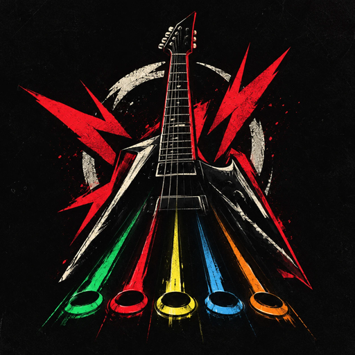

<div align="center">



# 🎸 RIFF RUSH

### Pega a guitarra. Chama a galera. Destrói o palco.

**Jogo de ritmo para desktop com multijogador local e online para até 4 pessoas.**
**Celular vira controle. Cada nota conta. Cada combo é seu.**


</div>

---

## 🔥 O que é

Riff Rush é um jogo de ritmo no estilo dos clássicos de guitarra de plástico: as notas descem pela pista, você acerta no tempo, monta combo e sobe de nível. Roda como app nativo (Tauri), com uma versão web que os celulares abrem para entrar na partida sem instalar nada.

## ⚡ Destaques

| | |
|---|---|
| 🎸 **Modo Rock** | Pista de 5 trilhos, sustains, combo, multiplicador e explosões neon. Lê charts no formato da comunidade. |
| 🎹 **Modo Mania** | Teclas verticais com beatmaps do osu!mania, motor próprio e leaderboard com download de mapas. |
| 👥 **Multijogador até 4** | Na LAN (servidor embutido no app) ou online (relay na Cloudflare). |
| 📱 **Celular como jogador** | Abra o endereço no navegador do celular e entre na sala. |
| 🛡️ **Anti-trapaça de verdade** | O motor da partida é um crate Rust: o app roda em WASM e a API **rejulga o replay** com as mesmas regras. |
| 🏆 **Progressão** | Login Google, XP, nível, ranking, perfil, amigos, chat, presença e log de atividades. |
| 🎮 **Gamepad e modificadores** | Suporte a controle e modificadores de partida. |
| 🔄 **Atualização automática** | Instalador assinado com updater integrado. |

## 🧠 Arquitetura

```
           ┌──────────────────────────────┐
           │   App desktop (Tauri + React) │──── servidor da LAN (Rust)
           │   motor em WASM               │           ▲
           └──────────────┬───────────────┘           │
                          │                    📱 celulares (web)
          ┌───────────────┼────────────────┐
          ▼                                ▼
 ┌─────────────────┐              ┌──────────────────┐
 │ API (Rust/axum) │              │ Relay (Cloudflare│
 │ contas, XP,     │              │ Worker) salas    │
 │ rejulga replays │              │ online           │
 └────────┬────────┘              └──────────────────┘
          ▼
     PostgreSQL
```

```
frontend/          o jogo: React + Tauri + versão web para os celulares
backend/           API em Rust (arquitetura hexagonal, por funcionalidade)
  motor/           regras do modo Rock (Rust → WASM e servidor)
  motor-mania/     regras do modo Mania
  relay/           Worker da Cloudflare do modo online
landing/           site de divulgação com demo jogável
```

## 🚀 Rodando

**Pré-requisitos:** Node.js, Rust (stable), PostgreSQL para a API e as [dependências do Tauri](https://tauri.app/start/prerequisites/).

### O jogo

```bash
cd frontend
npm install
npm run tauri dev   # app desktop
npm run dev         # só a versão web
```

### A API

```bash
cd backend
cp .env.example .env   # preencha as variáveis
sqlx migrate run
cargo run
```

### A landing

```bash
cd landing && npm install && npm run dev   # http://localhost:1440
```

### O relay

```bash
cd backend/relay && npm install && npm test
```

## 🧪 Testes

O projeto é feito em **TDD**: teste primeiro, código depois, e todo bug corrigido ganha um teste.

```bash
cd frontend && npm test
cd frontend && cargo test --manifest-path src-tauri/Cargo.toml
cd backend && cargo test -q && cargo clippy -- -D warnings
```

## 🛠️ Comandos úteis

| Comando | O que faz |
|---|---|
| `npm run motor` | Recompila os motores Rust para WASM (`-- mania` só o Mania) |
| `npm run build` | Typecheck + build web |
| `npm run lancar -- 0.2.0` | Sobe a versão e gera o instalador assinado + `latest.json` |

## 🤝 Contribuindo

- Commits convencionais em português: `feat: adiciona sustain nas notas`.
- Um PR por funcionalidade, sempre partindo da `main` e apontando para ela.
- Código em português, pastas em inglês.
- As regras completas estão no [`CLAUDE.md`](CLAUDE.md) e o visual em [`frontend/docs/design.md`](frontend/docs/design.md).

## 🌍 Deploy

A `main` não publica nada. O jogo web e a landing vão para o ar pela Vercel a partir da branch `producao`, via PR da `main` para a `producao`.

---

<div align="center">

**Feito com 🤘 e muito Rust.**

*Aumenta o volume.*

</div>
