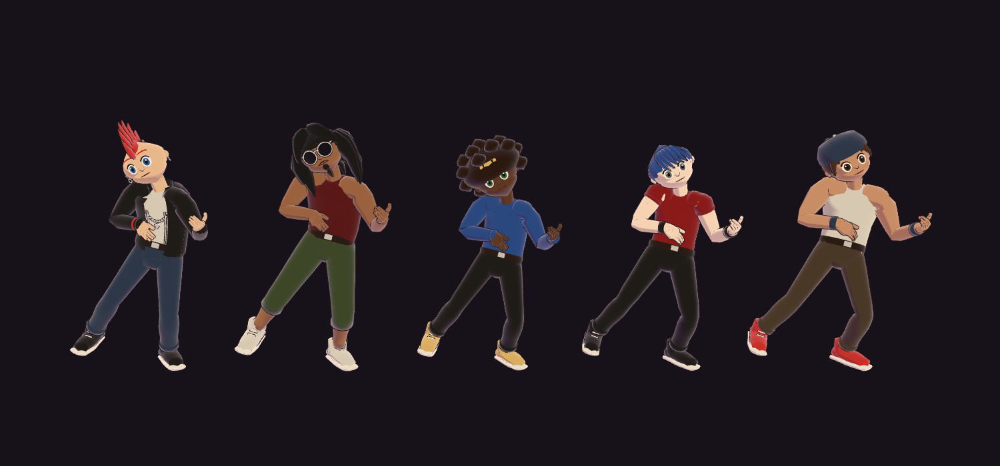
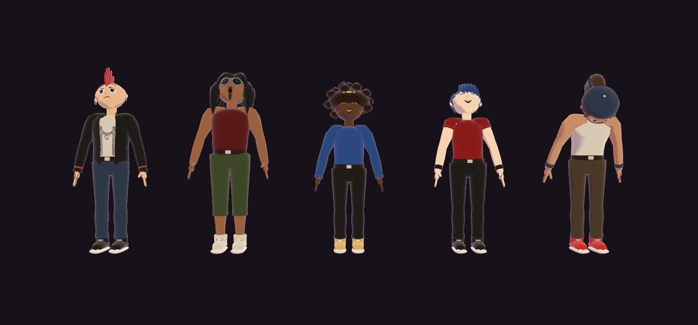

# Personagens

Como criar novos personagens 3D para o Riff Rush sem abrir o Blender, e como eles reagem à partida.



## Visão geral

Os personagens são arquivos **VRM 1.0** (um `.glb` com o esqueleto humanoide e as expressões descritas na extensão `VRMC_vrm`). O jogo carrega o VRM com `@pixiv/three-vrm`, aplica as animações da Mixamo por retarget (`render3d/retarget.ts`) e pinta as partes pelas cores escolhidas no criador de personagem.

Há dois caminhos para ter um personagem novo:

| Caminho | Quando usar |
|---|---|
| **Gerador procedural** (`scripts/gerar-personagem.mjs`) | Personagens estilizados no visual do jogo, feitos a partir de uma receita JSON. Rápido para criar a banda inteira. |
| **VRoid Studio / Booth** | Quando quiser um personagem anime detalhado. Exporte em `.vrm` e registre em `BASES`. |

Os dois produzem o mesmo tipo de arquivo, então o resto do jogo não muda.

## Gerar um personagem

1. Crie uma receita em `personagens/<id>.json` (copie uma das existentes).
2. Rode:

   ```bash
   node scripts/gerar-personagem.mjs personagens/<id>.json
   # ou todas de uma vez
   node scripts/gerar-personagem.mjs personagens/*.json
   ```

   O arquivo sai em `public/modelos/personagens/<id>.vrm`, e o script mostra triângulos e tamanho.
3. Registre em `BASES` em `src/modules/character/catalogo.ts`:

   ```ts
   { id: "<id>", rotulo: "Nome no menu", arquivo: "/modelos/personagens/<id>.vrm" },
   ```

O script só usa o Node, sem dependências. Cada personagem fica com **8–11 mil triângulos e 330–400 KB**.

## Receita

```json
{
  "id": "roqueiro",
  "nome": "Roqueiro",
  "altura": 1.62,
  "proporcoes": { "cabeca": 1, "ombros": 1, "quadril": 1, "bracos": 1, "pernas": 1, "barriga": 1, "maos": 1 },
  "cabelo": "moicano",
  "manga": "curta",
  "jaqueta": true,
  "calca": "reta",
  "acessorios": ["corrente", "munhequeira", "brinco"],
  "cores": {
    "pele": "#e8bf98", "cabelo": "#c8322b", "olhos": "#2b5c9c",
    "roupa": "#1f1d1b", "camiseta": "#d8d2c4", "calca": "#2d3a4f",
    "calcados": "#1f1d1b", "detalhe": "#c8322b"
  }
}
```

Todo campo é opcional; o que faltar usa o padrão do script. O `id` sai do nome do arquivo quando omitido. O script valida a receita e para com uma mensagem clara se algum valor não existir.

| Campo | Valores | Observação |
|---|---|---|
| `altura` | metros | Escala o modelo inteiro. O jogo espera algo entre 1,4 e 1,8. |
| `proporcoes.*` | 0,7 a 1,4 (1 = padrão) | `cabeca` maior deixa mais cartoon; `pernas` muda a altura do quadril; `maos` aumenta mãos e dedos. |
| `cabelo` | `espetado`, `moicano`, `franja`, `longo`, `rabo`, `black`, `careca` | Feitos de mechas: ficam com silhueta de anime. |
| `manga` | `regata`, `curta`, `longa` | Com jaqueta, a jaqueta sempre tem manga longa. |
| `jaqueta` | `true` / `false` | Jaqueta aberta com gola e zíper. Ela usa a cor `roupa`, e a blusa de baixo usa `camiseta`. |
| `calca` | `reta`, `bermuda` | |
| `acessorios` | `oculos`, `bandana`, `bone`, `corrente`, `munhequeira`, `brinco`, `barba` | Usam a cor `detalhe` (bandana, boné, munhequeira) ou metal (corrente, brinco, armação). A barba é um cavanhaque com bigode na cor do cabelo. |
| `cores.*` | `#rrggbb` | Cores iniciais. O jogador ainda troca pele, cabelo, olhos, roupa, calça e calçados no criador. |

## O que o arquivo gerado traz

**Esqueleto.** 52 ossos humanoides em pose T, olhando para +Z (padrão do VRM 1.0). São tronco, braços e pernas, mais **todos os dedos**: polegar (`Metacarpal`, `Proximal`, `Distal`) e indicador, médio, anelar e mínimo (`Proximal`, `Intermediate`, `Distal`). As trilhas de dedos das animações da Mixamo passam direto pelo retarget, então a mão fecha no braço da guitarra.

**Malha.** Braços, pernas e dedos são tubos contínuos que atravessam as juntas, com o peso dividido entre os ossos perto de cada dobra. Por isso cotovelos, joelhos e dedos dobram sem emenda.

**Rosto.** Olhos, boca, dentes, cílios e sobrancelhas são "adesivos" colados na superfície da cabeça: cada um é uma forma 2D projetada na pele. As expressões movem esses adesivos pela pele sem que eles afundem nela.

**Materiais.** MToon (cel-shading com contorno), com nomes no padrão do VRoid. O criador de personagem reconhece cada parte pelo nome (`aparencia.ts › categoriaDoMaterial`):

| Material | Parte colorível |
|---|---|
| `Body_00_SKIN` | pele |
| `Hair_00_HAIR`, `Brow_00_HAIR` | cabelo (as sobrancelhas acompanham) |
| `EyeIris_00_EYE` | olhos |
| `Tops_00_CLOTH` | roupa (camiseta, regata ou jaqueta) |
| `Bottoms_00_CLOTH` | calça |
| `Shoes_00_CLOTH` | calçados |
| `Inner_00_SHIRT`, `Shoes_00_SOLE`, `EyeWhite_00_FACE`, `FaceLine_00_FACE`, `FaceMouth_00_FACE`, `Teeth_00_FACE`, `Accessory_00_ACCE`, `Belt_00_ACCE`, `Metal_00_ACCE`, `Lens_00_ACCE` | — (cor fixa da receita) |

**Expressões.** Morph targets ligados às expressões padrão do VRM: `happy` (olhos fechados em arco e sorriso aberto com dentes), `sad`, `angry` (sobrancelhas franzidas e dentes cerrados), `relaxed`, `surprised` (olhos arregalados, pupilas pequenas e boca em O) e `blink`.

## Estender o gerador

O gerador tem três primitivas:

- `torno()`: sólido de revolução entre dois pontos, com perfil `[raio, t]`, achatável em elipse (`largura`, `fundo`) e que pode ficar aberto (`arco`), como a jaqueta.
- `tubo()`: tubo que segue um caminho de pontos, com espessura variável. É usado para mechas, braços, pernas, dedos, armação dos óculos e cadarços.
- `adesivo()`: forma 2D projetada no rosto, usada para olhos, boca, sobrancelhas, barba e lentes.

As auxiliares são `elipsoide()`, `curva()` (Bézier), `mecha()` (tubo cônico curvo), `formaDeDisco()` e `formaDeFaixa()`.

**Novo penteado.** Adicione o nome em `CABELOS` e um `case` em `montarPersonagem`. Comece com `calota()` (a "touca" de cabelo) e some `mecha(de, meio, ate, grossura)` usando `naCabeca(direção)` para achar pontos na cabeça. Mechas compridas podem dividir o peso entre `head` e `upperChest` (veja `pesoDoCabeloLongo`).

**Novo acessório.** Adicione em `ACESSORIOS` e um `if (tem("..."))`, colocando as peças em `M.detalhe` (cor da receita) ou `M.metal`.

**Nova expressão.** Nos adesivos do rosto, cada expressão é uma função que leva um ponto do adesivo (em `xy` relativo ao centro da cabeça, ou `u, w` normalizados) para o novo lugar. Inclua o nome em `EXPRESSOES` e use nomes de preset do VRM 1.0 (`aa`, `ih`, `ou`, `ee`, `oh` para a boca, por exemplo).

**Conferir.** Depois de mexer, abra o personagem na tela de Personagem com uma animação de guitarra e com cada expressão. Se uma peça aparecer escura ou "por dentro", provavelmente a ordem dos triângulos dela está invertida (veja `costurar`).

## Reações



O personagem reage aos momentos da partida com poses e expressões **somadas por cima** da animação que estiver tocando. Por isso as reações funcionam em qualquer personagem, gerado ou do VRoid, sem precisar de arquivos de animação.

| Reação | Quando | O que faz | Duração |
|---|---|---|---|
| `errou` | nota perdida | Tranco para trás com a cabeça de lado e cara de dor | 0,5 s |
| `nitro` | star power ativado | Olha para cima de boca aberta, depois sorri e bate cabeça | 1,6 s |
| `vitoria` | adversário terminou a música | Corpo para trás, cabeça balançando, sorriso | até a tela mudar |
| `derrota` | vaiado (vida zerou) | Desaba para a frente, cabeça baixa, triste | até a tela mudar |

**Onde está o código.**

- `character/reacao.ts`: funções puras. `reacaoDoAtor(tipo, desde)` devolve a pose e as expressões de cada instante; `novaReacao` e `reacaoDoFimDaPartida` criam as reações.
- `render3d/ator.ts`: lê `estado.reacao` (e o método `ator.reagir(tipo)`) e aplica a pose e as expressões a cada quadro.
- `gameplay/TelaDeJogo.tsx`: dispara `errou`, `nitro` e `derrota` a partir dos eventos da partida, no palco e no avatar do HUD.
- `multiplayer/componentes/Adversarios.tsx`: mostra `vitoria` ou `derrota` em quem já terminou.

**Como disparar.** A reação entra no estado do avatar como `{ tipo, contador }`. Um contador novo dispara a reação de novo, como o `pulso` dos acertos:

```ts
reacao = novaReacao(reacao, "nitro");
<Avatar personagem={p} reacao={reacao} />
```

**Nova reação.** Adicione o tipo em `TipoDeReacao` e em `DURACAO_DA_REACAO`, crie o `case` em `reacaoDoAtor` (escreva o teste antes) e dispare onde fizer sentido.

**Com animação da Mixamo.** Se quiser um movimento de corpo inteiro (um power slide na vitória, por exemplo), converta o FBX com `scripts/preparar-animacoes.mjs` e toque o clipe no ator com `crossFadeTo`, como `escolherAnimacao` já faz. A pose da reação continua somada por cima.

## Licença

Os personagens gerados são do projeto: o script grava `licenseUrl` VRM 1.0 com redistribuição e modificação permitidas. Registre cada personagem novo em `public/modelos/LICENCAS.md`.

## Atores filmados (pessoa de verdade em 2D)

Além dos personagens 3D, o jogo aceita gente de verdade filmada, no estilo dos jogos de luta digitalizados dos anos 90: a pessoa é recortada do vídeo e vira uma folha de sprites com poucas cores e pixels grandes. No palco ela aparece como um recorte de papelão, e as reações (erro, nitro, vitória, derrota) trocam de cena.

### Gravar

- Celular em pé, parado (apoiado em algo), com a pessoa de corpo inteiro no quadro.
- Fundo liso ajuda, mas não é obrigatório: o recorte é feito por IA.
- Grave tudo num vídeo só, fazendo as cenas em sequência, com uma pausa entre elas:

| Cena | O que fazer | Duração |
|---|---|---|
| `parado` | Em pé, olhando para a câmera | 1–2 s |
| `tocando` | Guitarra imaginária, no ritmo (vira loop) | 3–4 s |
| `errou` | Um tranco, cara de "ops" | ~0,5 s |
| `vaiado` | Cabeça baixa, ombros caídos (vira loop) | 1–2 s |
| `nitro` | Cabeça para trás e depois agitar muito | ~2 s |
| `vitoria` | Comemorar: braço para cima, pulo, power slide | ~1,5 s |

### Converter

Salve o vídeo em `assets-fonte/atores/` (essa pasta não vai para o git) e crie uma receita em `atores/<id>.json` com o início e o fim de cada cena, em segundos:

```json
{
  "nome": "Sorriso",
  "video": "../assets-fonte/atores/sorriso.mp4",
  "cenas": {
    "parado": [0.0, 1.4],
    "tocando": [1.5, 5.0],
    "errou": [5.35, 5.9],
    "vaiado": [5.5, 6.8],
    "nitro": [9.2, 11.0],
    "vitoria": [12.9, 14.5]
  }
}
```

Opcionais: `fps` (12), `altura` em pixels de cada quadro (256), `cores` (48) e `alturaEmMetros`, a altura da pessoa parada no palco (1,75). Depois rode:

```bash
pip install "rembg[cpu]" pillow numpy scipy   # uma vez; precisa do ffmpeg no PATH
python scripts/preparar-ator.py atores/<id>.json
```

O script recorta a pessoa com dois modelos de IA (cada um erra em quadros diferentes), descarta o que fica solto (cadeiras, gente passando atrás), enquadra todas as cenas do mesmo jeito e gera `public/modelos/atores/<id>/` com uma folha `.png` por cena e o `manifesto.json`. Na primeira vez ele baixa os modelos (~350 MB).

Registre em `BASES` com `tipo: "video"`:

```ts
{ id: "<id>", rotulo: "Nome (filmado)", arquivo: "/modelos/atores/<id>", tipo: "video" },
```

### No código

- `character/video.ts`: funções puras que escolhem a cena (`cenaDoAtor`) e o quadro (`quadroDaCena`, `recorteDoQuadro`).
- `render3d/atorDeVideo.ts`: o ator 2D, com a mesma interface do ator VRM.
- `render3d/ator.ts › criarAtor`: monta o ator certo conforme o tipo do modelo escolhido.

Cores, corpo e instrumento do criador de personagem não se aplicam a atores filmados: eles aparecem como foram gravados (inclusive com a guitarra imaginária).

**Combine antes com quem foi filmado.** O vídeo original fica só na sua máquina, mas as folhas de sprites vão para o repositório e para quem jogar.
